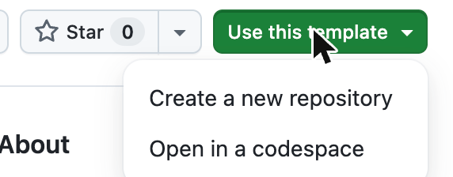
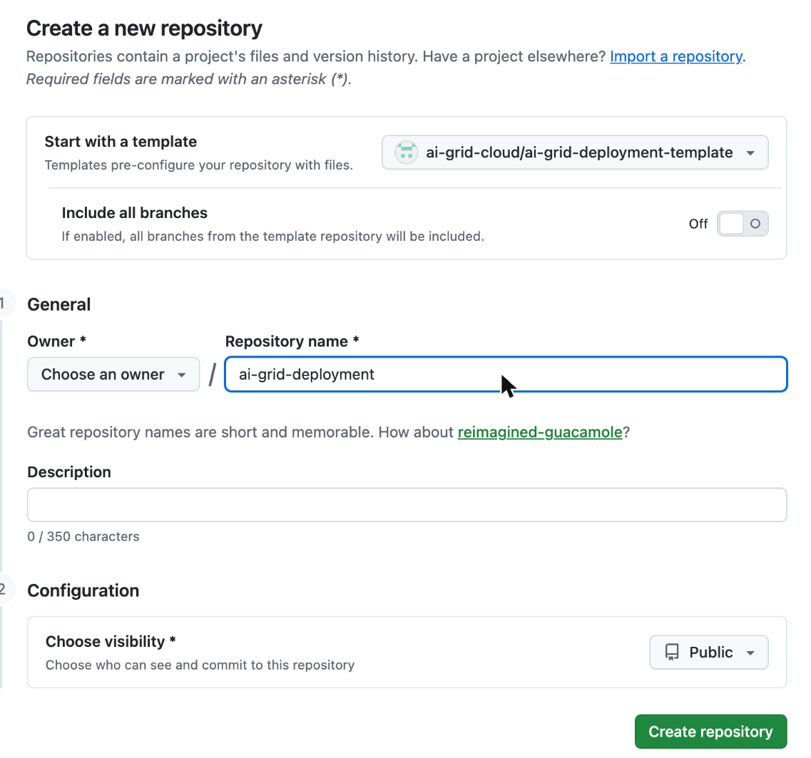

> **Prototype:** this template pins one fixed commit of
> [`ai-grid-cloud/ai-grid-cluster-gitops`](https://github.com/ai-grid-cloud/ai-grid-cluster-gitops) from branch
> `feat/deployment-inputs`, until that branch merges into `main`. The commit is `libraryRevision` in
> `root/kustomization.yaml`.

# AI Grid deployment template

A GitHub template for an AI Grid **deployment repository**. You create your own repository from it, and your hub's
Argo CD installs AI Grid from that repository:

- **On the hub:** ACM, the grid, the MaaS database and Redis, a Keycloak for tenants, and the provider console.
- **On each site:** OpenShift AI with MaaS and the grid, in the site's role.

The template carries choices tested end to end on 2026-11-10, so you change only your names.

## The three repositories

| Repository | What it holds | Who changes it |
|---|---|---|
| Library, [`ai-grid-cloud/ai-grid-cluster-gitops`](https://github.com/ai-grid-cloud/ai-grid-cluster-gitops) | The components (Argo CD applications, ACM policies, charts) and their reference docs | Its maintainers; you pin one commit and don't edit it |
| Your deployment repository, from this template | The library pin, which components run, your inputs, each site's files, the install guide and its scripts | You |
| Your catalog repository, created in the install guide | Models and subscriptions | The provider console |

The hub's Argo CD reads all three. Your deployment repository pins the library in `root/kustomization.yaml`, which
comes from the template, and names your repositories, the catalog among them, in `root/inputs.env`, which is yours
and which the template doesn't have; to upgrade, you move the library pin. For more, see
[How AI Grid works](https://github.com/ai-grid-cloud/ai-grid-cluster-gitops/blob/f5dfd38e2f7c949b2d198476a4e3c5602186aee7/docs/install/README.md#how-ai-grid-works).

## Start here

1. Create your deployment repository from this template:

   1. Click **Use this template** > **Create a new repository**.

      

   2. Choose the owner, name it, such as `ai-grid-deployment`, keep **Public**, and click **Create repository**. The
      hub's Argo CD reads it; this guide was tested with public repositories and doesn't cover the credentials that
      private ones need.

      

   With the GitHub CLI instead:

   ```sh
   gh repo create OWNER/DEPLOYMENT_REPO --template ai-grid-cloud/ai-grid-deployment-template --public
   ```

2. Follow the [install guide](docs/install/README.md) in your new repository.

## Update from the template

Your repository doesn't follow the template by itself. To pick up the template's later fixes, merge them in from
your repository's directory:

```sh
make update
```

It refuses to run while you have uncommitted changes. The first time, it finds the template commit your repository
started from, so git merges only what changed on each side since then. It never pushes. After the merge it runs
`scripts/check-deployment.sh`; if the check fails, it says `DON'T PUSH` and you fix what the check names first.

If your repository still has `root/inputs.yaml`, which the template replaced with `root/inputs.env`, `make update`
stops on a conflict in that file and prints the commands that move your values and finish the merge.

Review the merge and push:

```sh
git diff ORIG_HEAD
git push
```

If a file changed on both sides, it stops and names the file. Keep your values and the template's other changes in
it, then run `git add FILE` and `git commit`, or undo the merge with `git merge --abort`.
