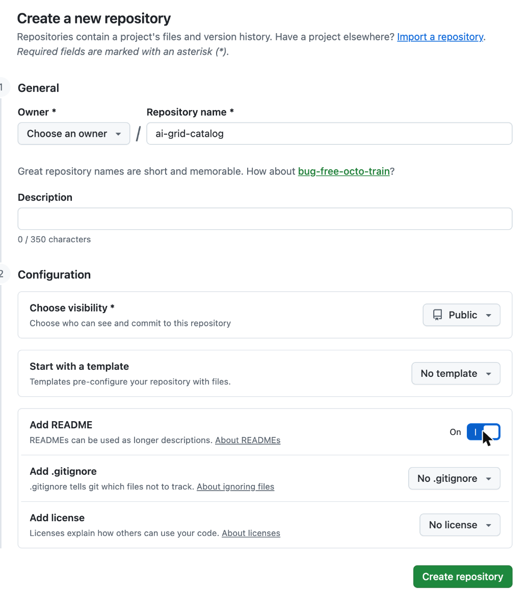
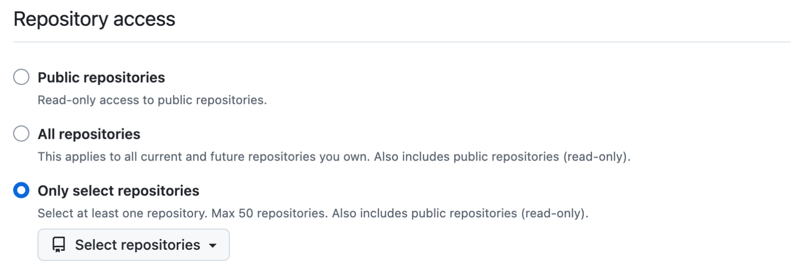
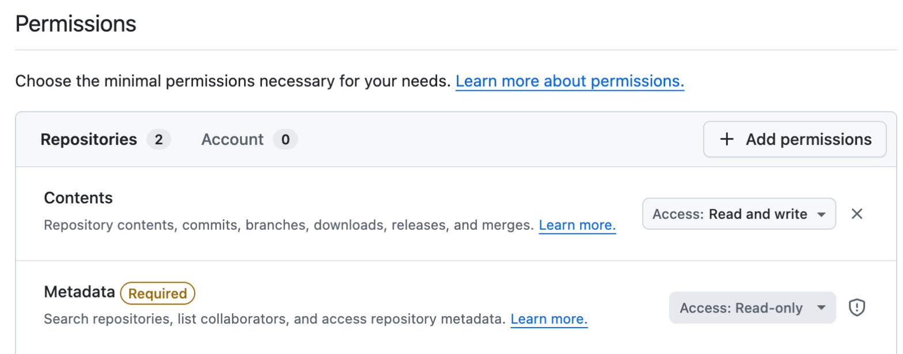

# Set up your deployment repository

Your deployment repository starts with the template's tested choices. On this page you create your catalog
repository, set the names that must be yours, check the result, and push it.

## 1. Clone your repository and log in to your clusters

1. Clone your deployment repository:

   ```sh
   git clone DEPLOYMENT_REPO_URL deployment && cd deployment
   ```

   Replace `DEPLOYMENT_REPO_URL` with your deployment repository's clone URL. Run every command in this guide from the
   `deployment` directory.

2. Name your clusters. Copy the example file:

   ```sh
   cp clusters-example.yaml clusters.yaml
   ```

   In `clusters.yaml`, replace each `REQUIRED-` value: the hub's API URL, and the site's name, location and API URL.
   Keep the hub's name, `hub`, and the site's role, `combined`: the guide's commands use them. To find a cluster's
   API URL, run `oc whoami --show-server` while logged in to it. For example:

   ```yaml
   apiVersion: ai-grid.dev/v1alpha1
   kind: Clusters
   hub:
     name: hub
     api: https://api.hub.example.com:6443
   sites:
     - name: site-east-1
       role: combined
       location: us-east
       api: https://api.site-east-1.example.com:6443
   ```

   The site's name becomes its ACM cluster name, and you can't change it once the site is imported. Commit
   `clusters.yaml` with your other changes in part 4; it records which clusters make up your grid, and holds no
   secrets.

3. Log in to each cluster as a `cluster-admin` user:

   ```sh
   make login
   ```

   For each cluster in `clusters.yaml`, it runs `oc login --web` against the cluster's API URL, which opens your
   browser, and saves the login in `.config/NAME/kubeconfig`, which git ignores. Your own kubeconfig isn't touched.
   Clusters you're still logged in to are skipped. When one login expires later, run `make login` again, or
   `make login NAME=hub` for one cluster. To use a kubeconfig you already have instead, such as the installer's
   `auth/kubeconfig`, copy it to `.config/NAME/kubeconfig`.

4. Check your prerequisites:

   ```sh
   make prereqs QUAY_AUTH_FILE=QUAY_AUTH_FILE
   ```

   Replace `QUAY_AUTH_FILE` with your container auth file with the pre-release registry logins, such as
   `~/.config/containers/auth.json`. Add `CATALOG_TOKEN_FILE=~/.ai-grid/catalog-token` after part 2.

   It checks your tools, each cluster in `clusters.yaml`, and your registry logins, and fetches the library at your pin
   into `.library/`, which git ignores. The scripts in `scripts/` use it. It changes nothing on your clusters and
   never blocks; checks whose input you haven't set yet print `skipped`. The output is similar to the following:

   ```text
   Tools
   ok       oc                               4.22.17
   MISSING  clusteradm                       imports the site into ACM
   ...
   Hub hub
   ok       reachable                        https://api.hub.example.com:6443
   ok       OpenShift 4.21 or later          4.22.18
   ...
   Site site-east-1 (combined)
   ok       ClusterIssuer                    letsencrypt-dns (DNS-01)
   ...
   20 ok, 1 missing, 1 skipped
   Nothing was changed; fix these before the page that needs them.
   ```

   Install any tool marked `MISSING` or `OLD` before you continue.

## 2. Create your catalog repository and its token

The catalog repository holds your models and subscriptions: the hub delivers them to your sites, and the provider
console writes them there with a token that can write only this repository.

1. [Create a new repository](https://github.com/new): name it, such as `ai-grid-catalog`, make it public, and turn on
   **Add README**.

   

   With the GitHub CLI instead:

   ```sh
   gh repo create OWNER/CATALOG_REPO --add-readme --public
   ```

2. [Create a fine-grained token](https://github.com/settings/personal-access-tokens/new), named such as `ai-grid-catalog`:

   1. Under **Repository access**, select **Only select repositories**, and select your catalog repository.

      

   2. Under **Permissions**, click **Add permissions** > **Contents**, then set it to **Read and write**. Leave every
      other permission off; GitHub adds **Metadata: Read-only** itself.

      

   3. Click **Generate token** and copy it.

   Note its expiration date: when it expires, the console can't save models or subscriptions until you replace it.

3. Save the token to a file outside your repository that only you can read, and never commit it:

   ```sh
   mkdir -p ~/.ai-grid && install -m 600 /dev/null ~/.ai-grid/catalog-token
   ```

   Paste the token into `~/.ai-grid/catalog-token` with an editor. You use it in
   [install the hub components](04-hub-components.md#2-create-the-consoles-secrets).

## 3. Set your names

Find each cluster's apps domain:

```sh
scripts/with-cluster.sh NAME oc get ingresses.config.openshift.io cluster -o jsonpath='{.spec.domain}{"\n"}'
```

Replace `NAME` with the cluster's name in `clusters.yaml`, such as `hub`. The output is similar to
`apps.hub.example.com`.

Replace each `REQUIRED-` placeholder:

| File | Placeholder | Set it to |
|---|---|---|
| `root/kustomization.yaml` | `REQUIRED-deploymentRepoURL` | Your deployment repository's URL, such as `https://github.com/my-org/ai-grid-deployment.git` |
| `root/kustomization.yaml` | `REQUIRED-catalogRepoURL` | Your catalog repository's URL, such as `https://github.com/my-org/ai-grid-catalog.git` |
| `root/kustomization.yaml` | `REQUIRED-idpIssuerURL` | `https://keycloak-tenant-idp.HUB_APPS_DOMAIN/realms/tenants`, with the hub's apps domain |
| `root/self.yaml` | `REQUIRED-deploymentRepoURL` | Your deployment repository's URL, as in `root/kustomization.yaml` |
| `tenant-idp/manifests/settings.yaml` | `REQUIRED-portalRedirectURI` | `https://maas.SITE_APPS_DOMAIN/*`, with the site's apps domain |

Keep every other value. Each one is a tested choice: for what it means and how to change it, see
[Appendix A: inputs and values](https://github.com/ai-grid-cloud/ai-grid-cluster-gitops/blob/d5021fa2080d013732825da29d1d2714d9eb0c54/docs/install/appendix-a-inputs.md) and
[Hub components](https://github.com/ai-grid-cloud/ai-grid-cluster-gitops/blob/d5021fa2080d013732825da29d1d2714d9eb0c54/docs/install/hub/README.md#select-components).

## 4. Check and push

1. Check your repository:

   ```sh
   scripts/check-deployment.sh
   ```

   You should see `root renders; every input is set; every repository is an input.` If you see
   `unset inputs:` or `placeholders left in your files:`, set the values it names and run it again.

2. Commit and push:

   ```sh
   git add -A && git commit -m "deployment: set our names" && git push origin HEAD:main
   ```

## Checkpoint

- `scripts/check-deployment.sh` prints `root renders; every input is set; every repository is an input.`
- Your deployment repository is pushed, your catalog repository has a `main` branch, and your catalog token is in
  `~/.ai-grid/catalog-token`.

Next: [3. Prepare the hub](03-prepare-hub.md)
